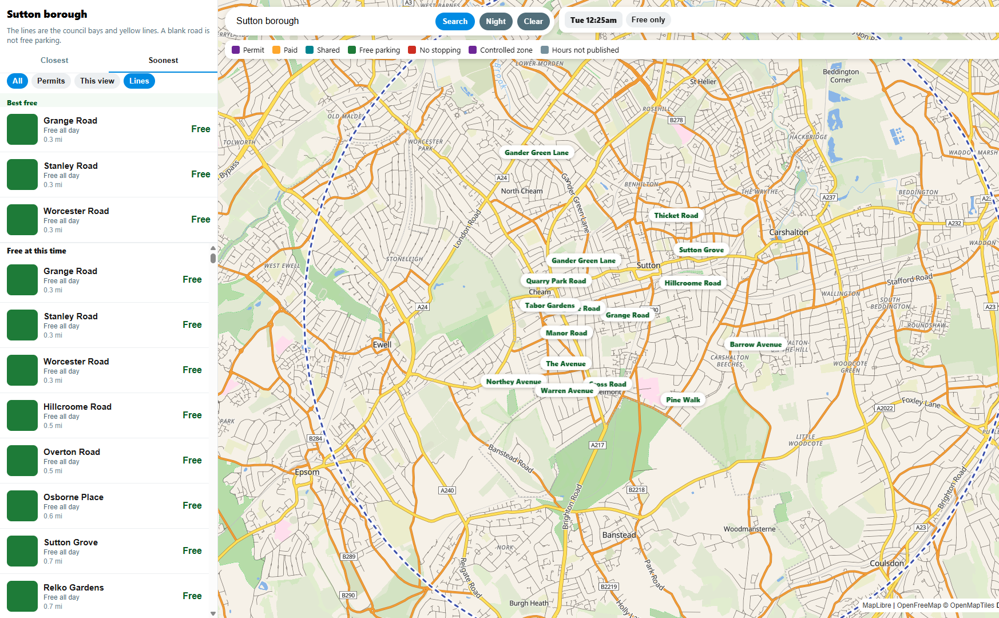
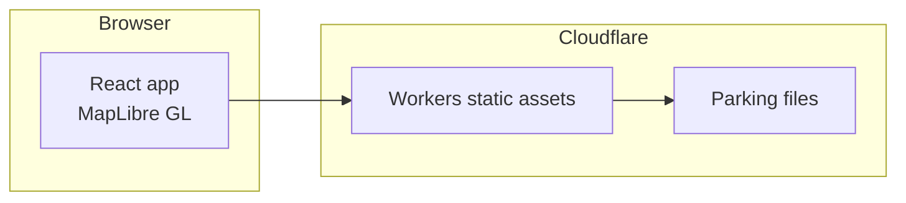

# Free parking finder

**Published parking restrictions, read from the kerb.**

Council bays and yellow lines where a file exists. Controlled zones where the file is only a zone. A blank road is not free parking.

[**Open the map**](https://freeparkingfinder.aden.website) · [Areas](https://arbzy1.github.io/freeparkingfinder/)

> The sign at the kerb wins. A gap between lines is not a free space. A zone shape is the controlled area, not a bay on every street.

## What it does

Search a place. The map moves there and lists the bays it can read. Free, pay, permit, and no-waiting stay in their own colours. A zone is never offered as a free street.

### Highlights

- **Kerb lines where the council published them.** Camden, the City of London, Epsom and Ewell, Islington, Kingston upon Thames, Southwark, and Sutton.
- **Red routes.** Transport for London restrictions on the roads TfL controls.
- **Zones kept as zones.** Barking and Dagenham, Enfield, and Wandsworth are controlled areas. Hammersmith and Fulham, Harrow, Kensington and Chelsea, Lambeth, Merton, and Newham are whole streets, not each bay.
- **Honest gaps.** Epsom and Ewell marks some roads only because the council file had no restriction line. Cardiff is a blue-permit street list, and the hours stay on the sign. A few extra bays come from OpenStreetMap and do not fill any borough.

## Areas

### Kerb lines

| Place | What is drawn |
|---|---|
| Camden | Council bays |
| City of London | Council bays |
| Epsom and Ewell | Council lines, plus roads with no restriction line in that file |
| Islington | Council bays and yellow lines, and the zone shapes |
| Kingston upon Thames | Council bays and yellow lines |
| Southwark | Council bays and yellow lines, and the zone shapes |
| Sutton | Council bays and yellow lines |
| Transport for London | Red-route restrictions |

### Zones and whole streets

| Place | What is drawn |
|---|---|
| Barking and Dagenham | Controlled zones |
| Enfield | Controlled zones |
| Wandsworth | Controlled zones |
| Hammersmith and Fulham | Whole streets |
| Harrow | Whole streets |
| Kensington and Chelsea | Whole streets |
| Lambeth | Whole streets |
| Merton | Whole streets |
| Newham | Whole streets |

### Other marks

| Place | What is drawn |
|---|---|
| Cardiff | Blue permit streets from the council list. Not a full bay survey. |
| OpenStreetMap | Individual bays. They do not complete a borough. |

## How it works

The browser loads the map and the parking files. Hours are read from those files. Nothing is guessed when a clock or a day is missing.

| Layer | Tech |
|---|---|
| Site | [Cloudflare Workers](https://developers.cloudflare.com/workers/) static assets |
| App | React, MapLibre GL |
| Map | [OpenFreeMap](https://openfreemap.org) Liberty style, OpenStreetMap data |

## Credits

Map data © [OpenStreetMap](https://www.openstreetmap.org/copyright) contributors. Basemap by [OpenFreeMap](https://openfreemap.org). Parking lines come from the council files named above, Transport for London red routes, and a small number of OpenStreetMap bays.
